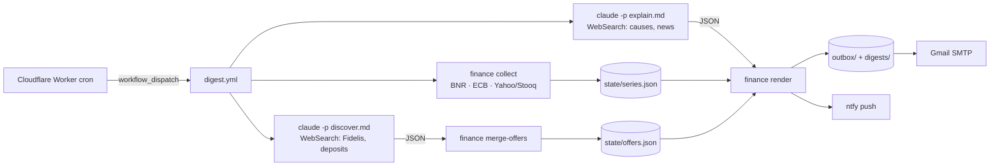

# finance-digest

> Daily email for a euro saver in Romania, sent while the sum is still uninvested. It reports the BNR EUR/RON and USD/RON rates and what moved them, global ETFs (S&P 500, Nasdaq-100, All-World) in the euro versions an EU resident can actually buy, ECB reference rates, and the offers open to a Romanian resident: Fidelis/Tezaur government bonds, EUR term deposits and savings accounts.

| Sources | Schedule | Delivery | State | Auth |
|---|---|---|---|---|
| BNR XML, ECB eurofxref + Data API, Yahoo chart API (Stooq fallback), Claude web search | Mon–Fri 17:00 UTC; Saturday 07:00 UTC (`mode=weekly`), dispatched by [gh-workflow-scheduler](../gh-workflow-scheduler) | Gmail SMTP + ntfy push | `data` branch: `state/`, `digests/`, `outbox/` | `CLAUDE_CODE_OAUTH_TOKEN` (subscription), Gmail app password |



## What it shows

- **FX**: the official BNR EUR/RON and USD/RON rates and the ECB EUR/USD rate. Each has its change over the day, 7 days and 30 days, plus the cause and a link for anything that moved more than its threshold.
- **ETFs**: SXR8 (S&P 500), SXRV (Nasdaq-100), VWCE (All-World) and XEON (EUR overnight cash) are UCITS ETFs quoted in EUR on Xetra. SPY and QQQ are listed as the US references the news talks about. Under the PRIIPs rules they cannot be sold to EU retail investors.
  - For SXR8 and SXRV the 7- and 30-day move is split into "index in USD" and "EUR/USD effect", because a stronger euro shrinks a US index measured in euro.
  - For XEON the digest gives the annualised 30-day yield, the benchmark to compare deposits against.
- **ECB rates**: the deposit facility rate and €STR.
- **Offers**: Fidelis/Tezaur issues, EUR deposits and savings accounts. Claude finds them, Python validates them, and only new offers or changed rates are reported. The Saturday edition also lists the best offers still active.

Every number comes from a deterministic script. Claude only writes the causes and the news list, and an explanation without a source link is dropped.

## Prerequisites

- [uv](https://docs.astral.sh/uv/) and `gh` (authenticated)
- Repo secrets:

| Secret | What |
|---|---|
| `CLAUDE_CODE_OAUTH_TOKEN` | `claude setup-token` (subscription, not API billing) |
| `MAIL_USERNAME` | Gmail address; sender and recipient |
| `MAIL_PASSWORD` | Gmail app password |
| `NTFY_TOPIC` | optional; the phone push is skipped without it |

```bash
pbpaste | tr -d ' \n\r' | gh secret set CLAUDE_CODE_OAUTH_TOKEN
```

## Quick start

```bash
make install
make test          # fixtures only, no network
make preview       # renders tests/fixtures/preview_*.json into preview.html
make probe         # probe.yml: every source from a runner IP, parsed
make run FORCE=true            # one daily digest now
make run MODE=weekly FORCE=true
```

## Layout

```text
src/finance/
  series.py     what is tracked (ids, tickers, thresholds) + state/series.json
  sources.py    BNR / ECB / Yahoo / Stooq parsers and collect()
  movers.py     changes per horizon, EUR/USD split, XEON yield, "notable"
  offers.py     validate Claude's offers, track new / changed rates
  prose.py      validate Claude's explanations (no link, no cause)
  outbox.py     pending -> sent, retried up to 5 times
  email/        Jinja2 templates + CSS (inlined for Gmail)
prompt/         discover.md (offers), explain.md (causes)
scripts/        probe.py, commit-data.sh
```

## ⚠️ Notes

- **Not investment advice.** The digest reports and attributes; it never recommends.
- Yahoo's chart API is unofficial. When it fails, Stooq is tried for each ticker. If both fail, the row keeps its last good value and the source counts a failure. Three failures in a row put a "surse degradate" banner in the email, at most once a week.
- Offers come from web search and are neither exhaustive nor guaranteed current. Always confirm the rate on the bank's or the Ministry's page before subscribing.
- The EUR/USD split is approximate: Xetra, NYSE and the ECB fixing close at different hours.
- A bar for a session still trading is dropped, so a US close shows up in the next day's digest.
